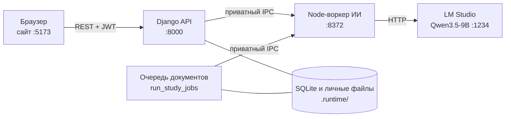

# LAT AI — LEARN AND TALK

Учебная платформа с локальным ИИ-репетитором: загрузите конспект, выберите фрагмент, и ИИ соберёт мини-курс или тест с подсказками, а баллы и прогресс посчитаются автоматически. Всё работает на вашем компьютере, без внешних сервисов и платных API.

> **Статус:** локальный пилот для Windows (loopback, не публичный хостинг). ИИ может ошибаться, об этом сказано и в интерфейсе.

*English: LAT AI is a local-first study platform. Upload your notes, pick a passage, and a local LLM builds a mini-course or quiz with hints and automatic scoring. Everything runs on one Windows PC.*

## Содержание

- [Возможности](#возможности)
- [Как это устроено](#как-это-устроено)
- [Быстрый старт (Windows)](#быстрый-старт-windows)
- [Как пройти сценарий](#как-пройти-сценарий)
- [Ограничения](#ограничения)
- [Проверки](#проверки)
- [Структура репозитория](#структура-репозитория)
- [Документация](#документация)
- [Лицензия](#лицензия)

## Возможности

- **Личные документы.** TXT, PDF, DOCX и PPTX. PDF должен содержать текстовый слой, распознавания сканов нет. Файлы и материалы видны только владельцу.
- **Мини-курс или тест из выбранного фрагмента.** Фрагмент от 100 до 6000 символов, любая учебная тема. Мини-курс состоит из 1–3 коротких уроков. Перед генерацией выбираются 5, 6 или 7 вопросов (по умолчанию 6), по четыре варианта в каждом. Сохранённые тесты первой версии с 3–6 вопросами остаются доступны. Генерация идёт в фоне, статус сохраняется при обновлении страницы.
- **Подсказки к тестам.** Подсказка исключает один неверный вариант и объясняет причину, остальные три остаются для самостоятельного выбора. Подсказка, не прошедшая проверку, не публикуется.
- **Автоматические баллы и прогресс.** После ответа видны верный вариант, разбор и цитата из текста. Повтор одной попытки баллы не добавляет, для каждого вопроса учитывается последний ответ.
- **Python-задания с автопроверкой.** Для 4 заданий ИИ оценивает текстовый ответ по критериям (балл, зачтённые критерии, что нужно уточнить) и записывает прогресс. ИИ-репетитор отвечает на вопросы по этим заданиям.
- **Приватность.** Документы не покидают компьютер: используются только локальные Django, Node-воркер и модель Qwen3.5-9B в LM Studio.

## Как это устроено



Браузер обращается только к Django, который проверяет пользователя и доступ. Воркер ИИ доступен лишь Django и обработчику очереди по приватному IPC с общим секретом, прямого доступа из браузера к нему нет. Один запуск `START_MAIN.cmd` поднимает четыре процесса: сайт, Django, воркер и обработчик очереди.

## Быстрый старт (Windows)

**Требования**

- Windows, Python 3.12 x64, Node.js 22.13+.
- LM Studio с CLI `lms` в `PATH`.
- Модель Qwen3.5-9B-Q4_K_M, импортированная в LM Studio (ключ `qwen3.5-9b`). Веса в репозиторий не входят; основной запуск и установка пилота их не скачивают.

**Установка**

```bat
git clone -c core.longpaths=true https://github.com/ranetochka14/lat-ai C:\LAT\lat-ai
cd C:\LAT\lat-ai
SETUP_PILOT.cmd
```

Клонируйте в короткий путь. `SETUP_PILOT.cmd` создаёт `.venv`, ставит зависимости из `requirements.txt` и Node-пакеты по lockfile.

**Запуск**

1. Включите локальный сервер LM Studio на `127.0.0.1:1234`.
2. Выполните `START_MAIN.cmd -CheckOnly`: он покажет, какие исходники, база, Python и Node будут использованы.
3. Выполните `START_MAIN.cmd` и оставьте окно открытым. `Ctrl+C` останавливает только процессы этого запуска.

| Что | Адрес |
| --- | --- |
| Сайт | http://127.0.0.1:5173/#/courses |
| Документы | http://127.0.0.1:5173/#/documents |
| API | http://127.0.0.1:8000/api/v1 |
| Django admin | http://127.0.0.1:8000/admin/ |

**Важно знать**

- Первый вход: зарегистрируйтесь на сайте. Создание администратора описано в [руководстве запуска](docs/dev/runbook.md).
- Данные (база, документы, секреты, логи) лежат в `.runtime/`, в Git они не попадают. На новом ПК используется `.runtime/i02`. Если есть `.runtime/main-local.json`, он имеет приоритет и указывает на действующую базу: не удаляйте его и сохраняйте при обновлении.
- `START_MAIN.cmd -WithoutModel` запускает сайт, Django, воркер и обработчик очереди без включения модели. Можно проверить интерфейс и обычные операции платформы; генерация ИИ недоступна.
- Нестандартные порты и восстановление после сбоя: [руководстве запуска](docs/dev/runbook.md).
- `START_PILOT.cmd` использует отдельный профиль и другую БД (`.runtime/pilot`); `START_AI_REVIEW.cmd` и `START-FULL.cmd` относятся к историческим профилям. Основной запуск — `START_MAIN.cmd`.

## Как пройти сценарий

1. Зарегистрируйтесь и откройте раздел «Документы».
2. Загрузите файл. Для пробы подойдут тексты из `tools/demo-materials/`.
3. Проверьте извлечённый текст в предпросмотре и выберите фрагмент.
4. Выберите число вопросов и подробность материала, нажмите «Мини-курс» или «Тест» и дождитесь готовности. Время зависит от компьютера, модели и очереди; бюджет одной генерации — до трёх минут, успешный результат за это время не гарантируется.
5. Прочитайте уроки или отвечайте на вопросы, при необходимости возьмите подсказку.
6. Балл, разбор и прогресс появятся автоматически. Python-курсы и их прогресс отделены от личных документов.

## Ограничения

- Ответы и ключи ИИ могут быть ошибочными. Проверки формата и цитат не доказывают истинность, а повторная проверка той же моделью не заменяет независимую экспертизу.
- Автоматическая оценка есть только для 4 заданий по Python. Свободные эссе по произвольным темам не оцениваются, «пройдено» означает «отвечено на все вопросы», а не освоение темы.
- Файл до 20 МиБ, извлечённый текст до 200 000 символов. Одна генерация охватывает только явно выбранный фрагмент, длинный документ целиком не обрабатывается.
- У пользователя одна активная генерация, в общей очереди до восьми. Неизвестный исход не ведёт к автоматическому повтору POST; при недоступности проверки приложение не выдаёт выдуманный результат.
- Запуск поддерживается только на Windows. Чистая установка на новом ПК пока не проверялась полностью.
- Это стенд на loopback. Тестовые пароли и настройки не подходят для интернет-развёртывания.

## Проверки

Проверки не требуют живой модели. В прогоне 12.11.2026 обнаружено 173 теста: 110 Node, 50 Django и 13 для интерфейса. Прошли 170; три Django-теста пропущены из-за отсутствующих необязательных парсеров PDF/DOCX/PPTX. Ошибок нет. Все 20 SHA ядра совпали. Проверяйте не только итог `OK`, но и пропуски.

```bat
npm --prefix integration/ai ci --ignore-scripts
npm --prefix integration/ai test
node integration/ai/check.mjs
node --test tests/document-pilot-frontend.test.cjs
.venv\Scripts\python.exe -B tools/pilot.py --runtime .runtime/verify prepare
.venv\Scripts\python.exe -B tools/pilot.py --runtime .runtime/verify manage test tutor progress documents courses
```

Отдельный `--runtime .runtime/verify` обязателен: не подставляйте действующий runtime. Тесты проверяют формат, контракты и поведение кода, но не педагогическое качество ответов ИИ. Порядок запуска — в [руководстве запуска](docs/dev/runbook.md), результаты предыдущих проверок — в [истории проверок](docs/dev/testing.md). Свежие результаты изменений приводятся в соответствующих PR.

## Структура репозитория

| Путь | Назначение |
| --- | --- |
| `index.html`, `assets/`, `server.cjs` | Сайт (статический интерфейс) и его локальный сервер |
| `backend/` | Django: `accounts`, `courses`, `documents`, `progress`, `tutor`, `config` |
| `integration/ai/` | Приватный Node-воркер ИИ, ядро репетитора, оценка, тесты и eval-наборы |
| `contracts/` | JSON-схемы контракта ИИ-репетитора |
| `tools/` | Запуск и подготовка окружения (`pilot.py`, `start-main.ps1`), демо-материалы |
| `tests/` | Тесты интерфейса |
| `docs/specs/` | Спецификации API, оценивания и документного пилота |
| `docs/dev/` | Решения, запуск и проверки для разработчиков |
| `docs/setup.md`, `docs/legacy/pilot-setup.md` | Подробные инструкции запуска |

## Документация

- [Решения, ограничения и следующая задача](docs/dev/notes.md)
- [Запуск, база, админка, проверки и восстановление](docs/dev/runbook.md)
- [Результаты проверок](docs/dev/testing.md)
- [Подробности запуска MAIN](docs/setup.md)
- [Отдельный профиль PILOT](docs/legacy/pilot-setup.md)
- [Правила разработки](docs/dev/CONTRIBUTING.md)
- [Учебный пакет 5–9 классов](docs/course-pack.md)
- [Спецификации](docs/specs/)
- [ИИ-модуль](integration/ai/README.md) и [схемы контракта](contracts/)

История разработки, отчёты и логи проверок хранятся в [ветке archive](https://github.com/ranetochka14/lat-ai/tree/archive). Для текущей работы начинайте с документации выше; архив не является активным планом разработки.

## Лицензия

Файл `LICENSE` в репозитории пока отсутствует. Условия использования и распространения уточняйте у владельца проекта.

Проект разрабатывался с использованием ИИ-ассистентов.
